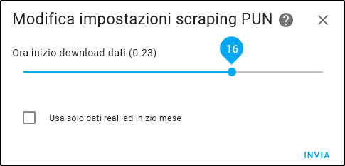
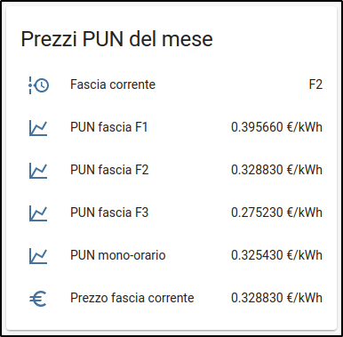
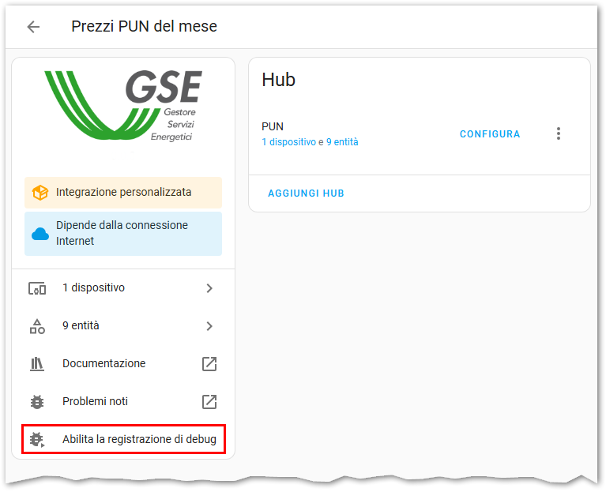
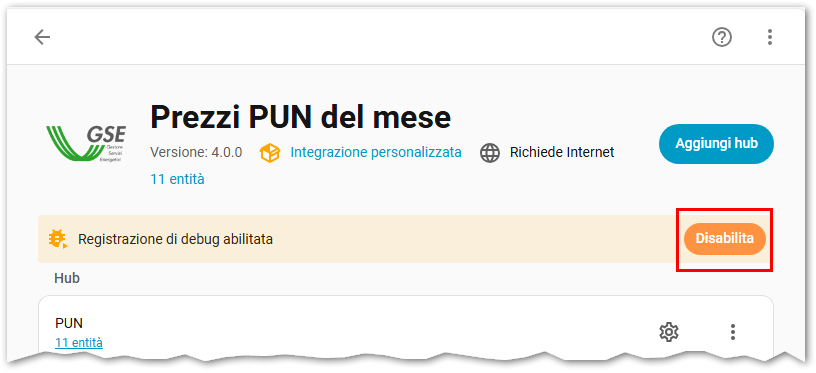
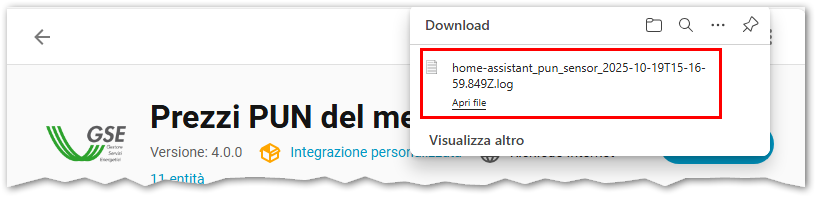

# Prezzi PUN del mese

[](https://www.home-assistant.io/integrations/marketplace/)

[](https://github.com/virtualdj/pun_sensor/actions/workflows/validate.yaml)
[](https://github.com/virtualdj/pun_sensor/releases)

Integrazione per **Home Assistant** (basata inizialmente sullo script [pun-fasce](https://github.com/virtualdj/pun-fasce)) che mostra i prezzi stimati del mese corrente per fasce orarie (F1, F2, F3, mono-oraria e F23\*) nonché la fascia oraria attuale.

I valori vengono scaricati dal sito [MercatoElettrico.org](https://gme.mercatoelettrico.org/it-it/Home/Esiti/Elettricita/MGP/Esiti/PUN) per l'intero mese e viene calcolata la media per fasce giorno per giorno, in questo modo verso la fine del mese il valore mostrato si avvicina sempre di più al prezzo reale del PUN in bolletta (per i contratti a prezzo variabile).

Oltre a questo, sono stati inseriti un sensore con il prezzo del PUN orario e uno con il prezzo zonale orario di un'area geografica selezionata in fase di configurazione.

## Installazione in Home Assistant

### Home Assistant 2026.11 e successive

HACS è integrato in Home Assistant come [Marketplace](https://www.home-assistant.io/integrations/marketplace/).
Non installare separatamente la vecchia integrazione HACS.

Aprire **Impostazioni > Marketplace**, scegliere **Aggiungi da link** (*Add from link*)
e inserire `https://github.com/virtualdj/pun_sensor`. Per aggiungere repository
personalizzati il Marketplace richiede il collegamento a GitHub. Aprire quindi
la pagina del repository, selezionare **Installa** e seguire la configurazione e le
eventuali richieste di riavvio mostrate da Home Assistant.

L'integrazione resta un componente della comunità: l'inclusione del Marketplace
nel Core non significa che questo codice sia verificato o supportato dal progetto
Home Assistant.

### Home Assistant 2026.10 e precedenti

Usare [HACS](https://hacs.xyz/) tramite il menu con i tre puntini nell'angolo in alto
a destra, scegliendo *Add custom repository* e aggiungendo
`https://github.com/virtualdj/pun_sensor` alla lista.

### Installazione manuale

Installare **manualmente** clonando o copiando questa repository e poi copiando la cartella `custom_components/pun_sensor` nella cartella `/custom_components/pun_sensor` di Home Assistant, che andrà successivamente riavviato.

### Configurazione

Dopo l'aggiunta dell'integrazione oppure cliccando il pulsante _Configurazione_ nelle impostazioni di Home Assistant, verrà visualizzata questa finestra:



La prima casella a discesa permette di selezionare la _zona geografica_ di riferimento per i prezzi zonali.

Tramite lo slider invece è possibile selezionare un'_ora del giorno_ in cui scaricare i prezzi aggiornati dell'energia (default: 1); il minuto di esecuzione, invece, è determinato automaticamente per evitare di gravare eccessivamente sulle API del sito (e mantenuto fisso, finché l'ora non viene modificata). Se per qualche ragione il sito non fosse raggiungibile, verranno effettuati altri tentativi dopo 10, 60, 120 e 180 minuti.

Nel caso si fosse interessati ai prezzi zonali, selezionare un'**orario uguale o superiore a 15**, così da essere sicuri che il GME abbia pubblicato i dati anche del **giorno successivo** (accessibili tramite gli [attributi dello stesso sensore](#prezzo-zonale)).

Se la casella di controllo _Usa solo dati reali ad inizio mese_ è **attivata**, all'inizio del mese quando non ci sono i prezzi per tutte le fasce orarie questi vengono disabilitati (non viene mostrato quindi un prezzo in €/kWh finché i dati non sono in numero sufficiente); nel caso invece la casella fosse **disattivata** (default) nel conteggio vengono inclusi gli ultimi giorni del mese precedente in modo da avere sempre un valore in €/kWh.

### Aggiornamento manuale

È possibile forzare un **aggiornamento manuale** richiamando il servizio _Home Assistant Core Integration: Aggiorna entità_ (`homeassistant.update_entity`) e passando come destinazione una qualsiasi entità tra quelle fornite da questa integrazione: questo causerà chiaramente un nuovo download immediato dei dati.

### Aspetto dei dati



L'integrazione fornisce il nome della fascia corrente relativa all'orario di Home Assistant (tra F1 / F2 / F3), i prezzi delle tre fasce F1 / F2 / F3 più la fascia mono-oraria, la [fascia F23](#fascia-f23-)\* e il prezzo della fascia corrente. Questi sono i dati intesi come mensili, da paragonare a quelli in bolletta una volta aggiunti costi fissi e tasse (vedere [_prezzo al dettaglio_](#prezzo-al-dettaglio)).

Poi ci sono i sensori con i prezzi orari (con il simbolo dell'orologio nell'icona), ad esempio utilizzabili per calcoli con impianti fotovoltaici: [PUN orario](#pun-orario-e-pun-15-minuti) e [prezzo zonale](#prezzo-zonale) che dalla versione 4 (ottobre 2025) sono disponibili anche nelle varianti a 15 minuti.

### Prezzo al dettaglio

Questo componente fornisce informazioni sul prezzo all'**ingrosso** dell'energia elettrica: per calcolare il prezzo al dettaglio, è necessario creare un sensore fittizio (o _template sensor_), basato sui dati specifici del proprio contratto con il fornitore finale aggiungendo tasse e costi fissi.

Di seguito un esempio di un sensore configurato manualmente modificando il file `configuration.yaml` di Home Assistant:

```yml
# Template sensors section
template:
  - sensor:
      - unique_id: prezzo_attuale_energia_al_dettaglio
        name: "Prezzo attuale energia al dettaglio"
        icon: mdi:currency-eur
        unit_of_measurement: "€/kWh"
        state: >
          {{ (1.1 * (states('sensor.pun_prezzo_fascia_corrente')|float(0) + 0.0087 + 0.04 + 0.0227))|round(3) }}
```

### Fascia F23 (\*)

A partire dalla versione v0.5.0, è stato aggiunto il sensore relativo al calcolo della fascia F23, cioè quella contrapposta alla F1 nella bioraria. Il calcolo non è documentato molto nei vari siti (si veda [QUI](https://github.com/virtualdj/pun_sensor/issues/24#issuecomment-1806864251)) e non è affatto la media dei prezzi in F2 e F3 come si potrebbe pensare: c'è invece una percentuale fissa, [come ha scoperto _virtualj_](https://github.com/virtualdj/pun_sensor/issues/24#issuecomment-1829846806).
Pertanto, seppur questo metodo non sia ufficiale, è stato implementato perché i risultati corrispondono sempre alle tabelle pubblicate online.

### Prezzo zonale

Oltre al prezzo zonale corrente, negli **attributi** del sensore vengono memorizzati i prezzi scaricati per la giornata di **oggi** e **domani** con il nome dell'attributo pari alla data di inizio di validità del prezzo nel formato `YYYY-MM-DD HH:MM:SS+ZZ:ZZ`.
Di seguito un esempio di come visualizzarli e/o utilizzarli in un template.

```jinja
Prezzo zonale di oggi e domani

  {# Esempio di formattazione diversa dell'orario #}
  
  {{ orario_dt.strftime('%a %d/%m/%Y %H:%M %z') }} = 
    {{ "%.6f" % prezzo }} €/kWh
  
    n.d.
  


{# Esempio di recupero del prossimo prezzo zonale #}


Prezzo zonale prossimo = {{ "%.6f" % prezzo_prossimo }} €/kWh
({{ orario_prossimo }})

{# Esempio di recupero del prossimo prezzo zonale da 15 minuti #}



Prezzo zonale prossimo da 15 minuti = {{ "%.6f" % prezzo_prossimo_15min }} €/kWh
({{ orario_prossimo_15min }})
```

I dati sono visibili anche in _Home Assistant > Strumenti per sviluppatori > Stati_ filtrando `sensor.pun_prezzo_zonale` come entità e attivando la casella di controllo _Attributi_. Lo stesso vale per i prezzi a 15 minuti, filtrando `sensor.pun_prezzo_zonale_15min`.

### PUN orario e PUN 15 minuti

In maniera simile al prezzo zonale, anche i valori del PUN orario (nome sensore: `sensor.pun_orario`) e PUN 15 minuti (nome sensore: `pun_15min`) hanno gli attributi con i prezzi di oggi e domani, se disponibili.

### In caso di problemi

Le medie mensili e il prezzo della fascia corrente espongono anche gli attributi
`dati_del`, `ultimo_aggiornamento` e `dati_non_aggiornati`. Un errore di rete non
cancella l'ultima acquisizione valida della giornata, ma la contrassegna come non
aggiornata. Il semplice passaggio di ora o fascia non cancella l'errore di download.
Le medie del giorno precedente e i vecchi backup senza data non vengono mostrati
come medie aggiornate: occorre una nuova acquisizione. Il ripristino del prezzo
della fascia corrente richiede anche che la fascia memorizzata corrisponda a quella
attuale. I prezzi orari e a 15 minuti restano legati al loro preciso intervallo.

È possibile abilitare la registrazione dei log tramite l'interfaccia grafica in **Impostazioni > Dispositivi e servizi > Prezzi PUN del mese** e cliccando sul pulsante **⋮ > Abilita la registrazione di debug**.



Il tasto verrà modificato come nell'immagine qui sotto; dopo che si verifica il problema, premere su **Disabilita**.



In questo modo verrà scaricato un file di log con le informazioni da allegare alle [Issue del progetto](https://github.com/virtualdj/pun_sensor/issues), dopo aver rimosso eventuali dati personali o credenziali.



## Note di sviluppo

### Test di regressione

Usare un ambiente separato da Home Assistant di produzione con Python 3.14:

```sh
python3.14 -m venv .venv
.venv/bin/python -m pip install -r requirements_test.txt
.venv/bin/python -m pytest tests -q
.venv/bin/python -m ruff check custom_components/pun_sensor tests
.venv/bin/python -m ruff format --check custom_components/pun_sensor tests
```

Le dipendenze di test fissano Home Assistant 2026.10.4. I test usano una sua
istanza temporanea, archivi XML sintetici e risposte HTTP simulate; le connessioni
di rete sono bloccate. Non accedono a un'istanza HA reale né al GME. La suite copre
parser/DST, duplicati e intervalli fuori giornata, cache e cambio zona,
unload/reload, errori e ripristino. Verifica inoltre il download automatico,
mezzanotte e cambio mese con un orologio simulato, le traduzioni del selettore e
il generatore del manifest di release. Non certifica tutte le versioni di HA o
la correttezza dei rendiconti GSE. I controlli GitHub Actions sono
predisposti anche per i branch di sviluppo e per le PR, con permessi in sola lettura.

Il selettore distingue le zone italiane (`Italia (…)`), le zone virtuali estere
(`Estero (…)`) e le interconnessioni di coupling (`Scambio (…)`). Le etichette
non modificano i codici GME salvati. Corsica e Corsica AC sono zone virtuali
estere, non zone geografiche italiane: vedere il
[catalogo delle zone GME](https://gme.mercatoelettrico.org/portals/0/Documents/it-IT/20231018_ME_Zone.pdf).

Restano da irrobustire la diagnostica e il recupero delle curve di domani o a 15 min
quando sono incomplete, senza invalidare quelle di oggi. La compatibilità con
il minimo HA 2023.4 dichiarato storicamente non è coperta dalla suite attuale.

Ho lasciato un diario dell'esperienza di programmazione di questa integrazione in [questa pagina](DEVELOPMENT.md). Potrete trovare qualche lamentela, ma soprattutto link alle pagine dei progetti che mi hanno aiutato a svilupparla così com'è ora.
